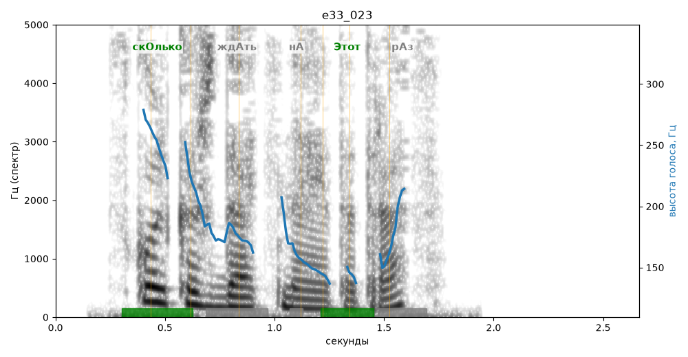

# e33_023

Голос: **edge:ru-RU-SvetlanaNeural** · длительность 2.7 с
Естественность (UTMOS): **3.78 из 5** (живой диктор ≈ 4–4.5)
Эталон: Сколько ждать на этот раз?
Распознано: Сколько ждать на этот раз?
Слова: все совпали

## Ударения
(где нужно: ruaccent)

| слово | нужно | у голоса | |
|---|---|---|---|
| сколько | скОлько | скОлько | ✓ |
| этот | Этот | Этот | ✓ |

## Интонация
- ✗ «сколько ждать на этот раз?» — конец фразы не понижается — звучит незаконченно / как перечисление
- Диапазон голоса 10.3 полутонов (живо), средняя высота 173 Гц

## Паузы и темп
- паузы на своих местах
- Темп 5.0 слога/с (нормально)

_Синяя линия — высота голоса. Над словами заглавная буква — где ударение должно быть; красным — голос поставил не туда (уверенно), оранжевым — возможно._
