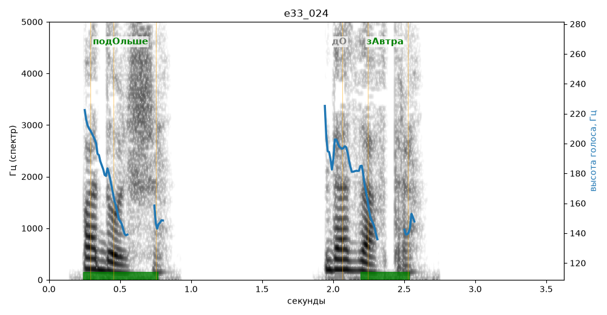

# e33_024

Голос: **edge:ru-RU-SvetlanaNeural** · длительность 3.6 с
Естественность (UTMOS): **3.67 из 5** (живой диктор ≈ 4–4.5)
Эталон: Подольше. До завтра.
Распознано: Подольше. До завтра.
Слова: все совпали

## Ударения
(где нужно: ruaccent)

| слово | нужно | у голоса | |
|---|---|---|---|
| подольше | подОльше | подОльше | ✓ |
| завтра | зАвтра | зАвтра | ✓ |

## Интонация
- ✗ «подольше.» — конец фразы не понижается — звучит незаконченно / как перечисление
- ✗ «до завтра.» — конец фразы не понижается — звучит незаконченно / как перечисление
- Диапазон голоса 7.1 полутонов (живо), средняя высота 181 Гц

## Паузы и темп
- паузы на своих местах
- Темп 5.7 слога/с (нормально)

_Синяя линия — высота голоса. Над словами заглавная буква — где ударение должно быть; красным — голос поставил не туда (уверенно), оранжевым — возможно._
