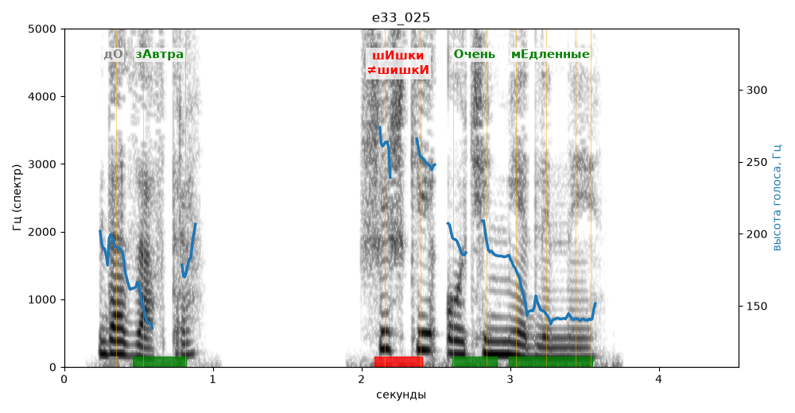

# e33_025

Голос: **edge:ru-RU-SvetlanaNeural** · длительность 4.5 с
Естественность (UTMOS): **4.11 из 5** (живой диктор ≈ 4–4.5)
Эталон: До завтра? Шишки очень медленные.
Распознано: До завтра! Шишки очень медленные!
Слова: все совпали

## Ударения
(где нужно: ruaccent)

| слово | нужно | у голоса | |
|---|---|---|---|
| завтра | зАвтра | зАвтра | ✓ |
| шишки | шИшки | шишкИ | ✗ ОШИБКА |
| очень | Очень | Очень | ✓ |
| медленные | мЕдленные | мЕдленные | ✓ |

## Интонация
- ✗ «до завтра?» — нет вопросительного подъёма (самое высокое место — «до», в начале) — звучит как утверждение
- ✓ «шишки очень медленные.» — конец фразы понижается — звучит законченно
- Диапазон голоса 10.7 полутонов (живо), средняя высота 178 Гц

## Паузы и темп
- паузы на своих местах
- Темп 6.2 слога/с (нормально)

_Синяя линия — высота голоса. Над словами заглавная буква — где ударение должно быть; красным — голос поставил не туда (уверенно), оранжевым — возможно._
