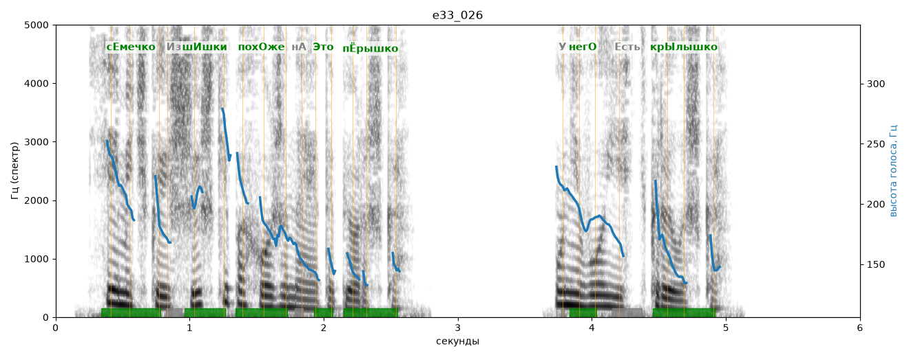

# e33_026

Голос: **edge:ru-RU-SvetlanaNeural** · длительность 6.0 с
Естественность (UTMOS): **3.87 из 5** (живой диктор ≈ 4–4.5)
Эталон: Семечко из шишки похоже на это пёрышко. У него есть крылышко.
Распознано: Семечка и шишки похожи на это пёрышка. У него есть крылышка.
Расхождения в словах: «семечко из» → «семечка и»; «похоже» → «похожи»; «перышко» → «перышка»; «крылышко» → «крылышка»

## Ударения
(где нужно: ruaccent)

| слово | нужно | у голоса | |
|---|---|---|---|
| семечко | сЕмечко | сЕмечко | ✓ |
| шишки | шИшки | шИшки | ✓ |
| похоже | похОже | похОже | ✓ |
| это | Это | Это | ✓ |
| пёрышко | пЁрышко | пЁрышко | ✓ |
| него | негО | негО | ✓ |
| крылышко | крЫлышко | крЫлышко | ✓ |

## Интонация
- ✓ «семечко из шишки похоже на это пёрышко.» — конец фразы понижается — звучит законченно
- ✓ «у него есть крылышко.» — конец фразы понижается — звучит законченно
- Диапазон голоса 9.3 полутонов (живо), средняя высота 178 Гц

## Паузы и темп
- паузы на своих местах
- Темп 6.6 слога/с (быстро)

_Синяя линия — высота голоса. Над словами заглавная буква — где ударение должно быть; красным — голос поставил не туда (уверенно), оранжевым — возможно._
