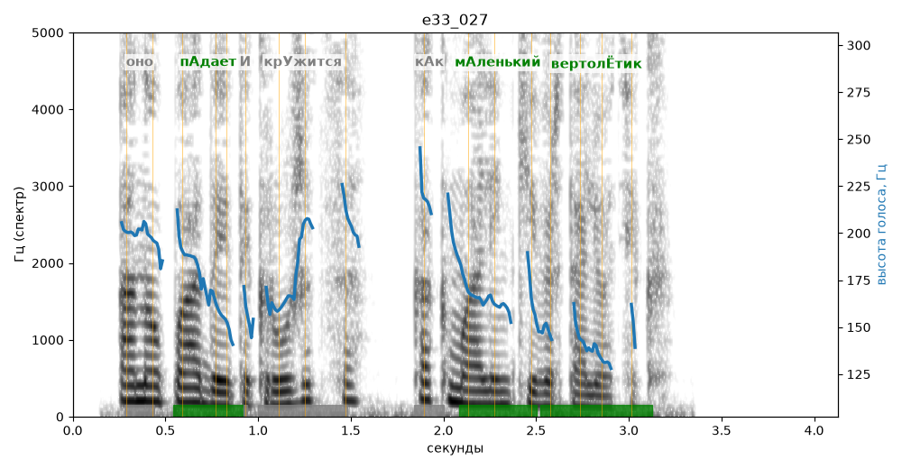

# e33_027

Голос: **edge:ru-RU-SvetlanaNeural** · длительность 4.1 с
Естественность (UTMOS): **3.75 из 5** (живой диктор ≈ 4–4.5)
Эталон: Оно падает и кружится, как маленький вертолётик.
Распознано: Оно падает и кружится, как маленький вертолетик.
Слова: все совпали

## Ударения
(где нужно: ruaccent)

| слово | нужно | у голоса | |
|---|---|---|---|
| оно | оно | онО | нет эталона |
| падает | пАдает | пАдает | ✓ |
| кружится | крУжится | кружитсЯ | ? не разобрать |
| маленький | мАленький | мАленький | ✓ |
| вертолётик | вертолЁтик | вертолЁтик | ✓ |

## Интонация
- ✓ «оно падает и кружится как маленький вертолётик.» — конец фразы понижается — звучит законченно
- Диапазон голоса 7.6 полутонов (живо), средняя высота 167 Гц

## Паузы и темп
- паузы на своих местах
- Темп 6.8 слога/с (быстро)

_Синяя линия — высота голоса. Над словами заглавная буква — где ударение должно быть; красным — голос поставил не туда (уверенно), оранжевым — возможно._
