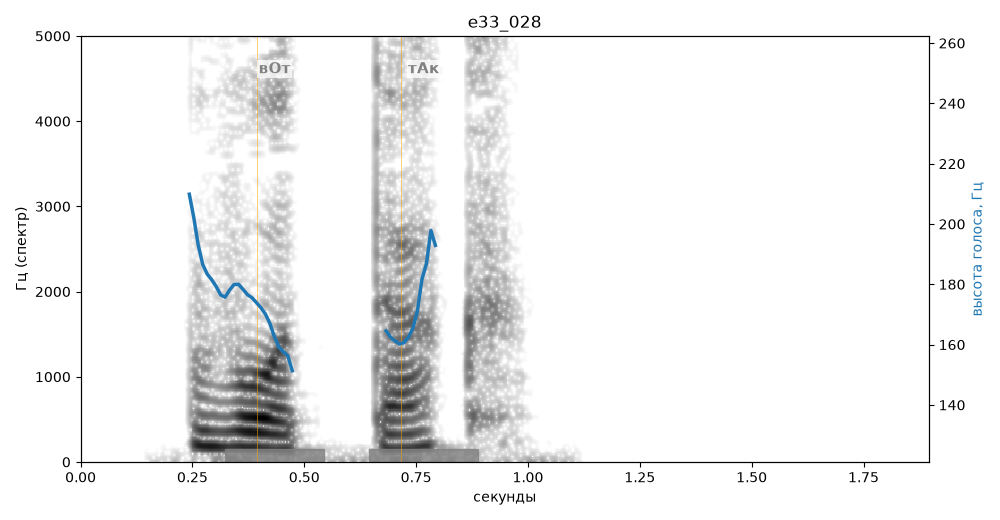

# e33_028

Голос: **edge:ru-RU-SvetlanaNeural** · длительность 1.9 с
Естественность (UTMOS): **3.6 из 5** (живой диктор ≈ 4–4.5)
Эталон: Вот так?
Распознано: Вот так.
Слова: все совпали

## Ударения
(где нужно: дано в тексте)

| слово | нужно | у голоса | |
|---|---|---|---|

## Интонация
- Диапазон голоса 4.1 полутонов (монотонно, как робот), средняя высота 176 Гц

## Паузы и темп
- паузы на своих местах
- Темп 3.5 слога/с (медленно)

_Синяя линия — высота голоса. Над словами заглавная буква — где ударение должно быть; красным — голос поставил не туда (уверенно), оранжевым — возможно._
