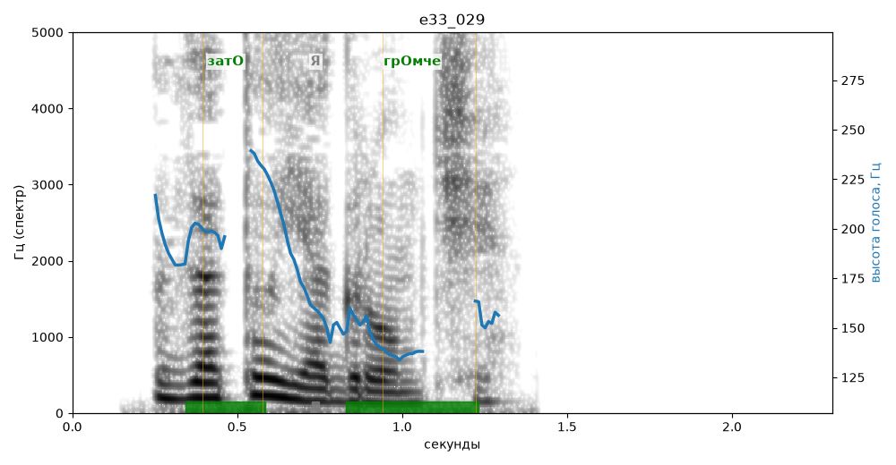

# e33_029

Голос: **edge:ru-RU-SvetlanaNeural** · длительность 2.3 с
Естественность (UTMOS): **3.99 из 5** (живой диктор ≈ 4–4.5)
Эталон: Зато я громче!
Распознано: Зато я громче.
Слова: все совпали

## Ударения
(где нужно: ruaccent)

| слово | нужно | у голоса | |
|---|---|---|---|
| зато | затО | затО | ✓ |
| громче | грОмче | грОмче | ✓ |

## Интонация
- ✓ «зато я громче!» — выделено слово «зато» (+3.7 пт)
- Диапазон голоса 9.1 полутонов (живо), средняя высота 163 Гц

## Паузы и темп
- паузы на своих местах
- Темп 4.5 слога/с (нормально)

_Синяя линия — высота голоса. Над словами заглавная буква — где ударение должно быть; красным — голос поставил не туда (уверенно), оранжевым — возможно._
