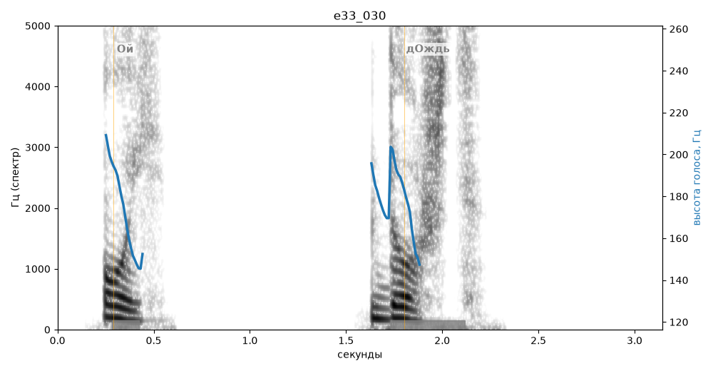

# e33_030

Голос: **edge:ru-RU-SvetlanaNeural** · длительность 3.1 с
Естественность (UTMOS): **3.74 из 5** (живой диктор ≈ 4–4.5)
Эталон: Ой! Дождь!
Распознано: Ой! Дождь!
Слова: все совпали

## Ударения
(где нужно: дано в тексте)

| слово | нужно | у голоса | |
|---|---|---|---|

## Интонация
- Диапазон голоса 5.6 полутонов (нормально), средняя высота 178 Гц

## Паузы и темп
- паузы на своих местах
- Темп 3.8 слога/с (медленно)

_Синяя линия — высота голоса. Над словами заглавная буква — где ударение должно быть; красным — голос поставил не туда (уверенно), оранжевым — возможно._
