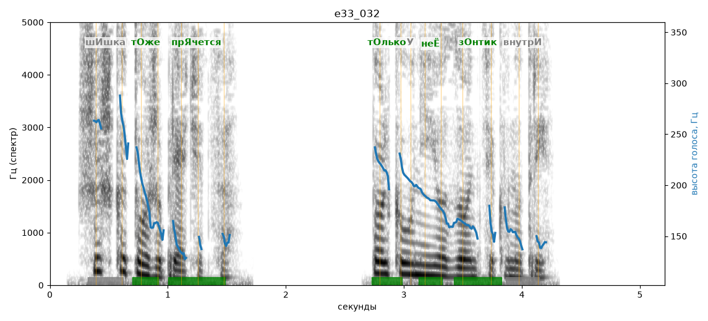

# e33_032

Голос: **edge:ru-RU-SvetlanaNeural** · длительность 5.2 с
Естественность (UTMOS): **3.71 из 5** (живой диктор ≈ 4–4.5)
Эталон: Шишка тоже прячется. Только у неё зонтик внутри!
Распознано: Шишка тоже прячется. Только у нее зонтик внутри.
Слова: все совпали

## Ударения
(где нужно: ruaccent)

| слово | нужно | у голоса | |
|---|---|---|---|
| шишка | шИшка | шишкА | ? не разобрать |
| тоже | тОже | тОже | ✓ |
| прячется | прЯчется | прЯчется | ✓ |
| только | тОлько | тОлько | ✓ |
| неё | неЁ | неЁ | ✓ |
| зонтик | зОнтик | зОнтик | ✓ |
| внутри | внутрИ | внУтри | ? не разобрать |

## Интонация
- ✓ «шишка тоже прячется.» — конец фразы понижается — звучит законченно
- ✓ «только у неё зонтик внутри!» — выделено слово «только» (+3.9 пт)
- Диапазон голоса 10.9 полутонов (живо), средняя высота 166 Гц

## Паузы и темп
- паузы на своих местах
- Темп 6.2 слога/с (нормально)

_Синяя линия — высота голоса. Над словами заглавная буква — где ударение должно быть; красным — голос поставил не туда (уверенно), оранжевым — возможно._
