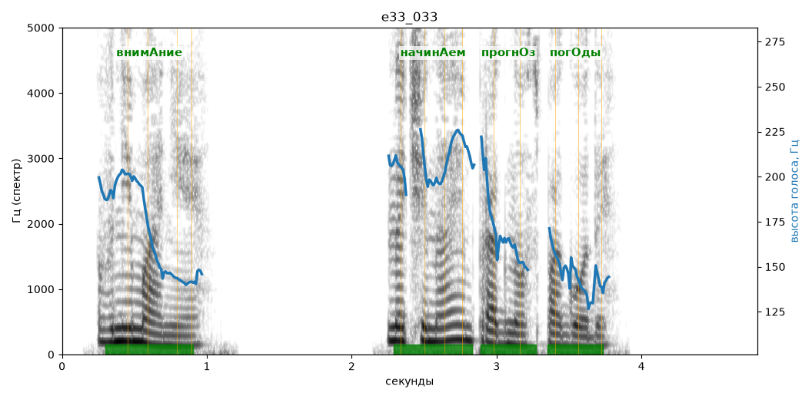

# e33_033

Голос: **edge:ru-RU-SvetlanaNeural** · длительность 4.8 с
Естественность (UTMOS): **4.01 из 5** (живой диктор ≈ 4–4.5)
Эталон: Внимание! Начинаем прогноз погоды!
Распознано: Внимание! Начинаем прогноз погоды.
Слова: все совпали

## Ударения
(где нужно: ruaccent)

| слово | нужно | у голоса | |
|---|---|---|---|
| внимание | внимАние | внимАние | ✓ |
| начинаем | начинАем | начинАем | ✓ |
| прогноз | прогнОз | прогнОз | ✓ |
| погоды | погОды | погОды | ✓ |

## Интонация
- ✗ «внимание!» — восклицание звучит ровно, без эмоции
- ✓ «начинаем прогноз погоды!» — выделено слово «начинаем» (+2.5 пт)
- Диапазон голоса 8.1 полутонов (живо), средняя высота 167 Гц

## Паузы и темп
- паузы на своих местах
- Темп 6.3 слога/с (нормально)

_Синяя линия — высота голоса. Над словами заглавная буква — где ударение должно быть; красным — голос поставил не туда (уверенно), оранжевым — возможно._
