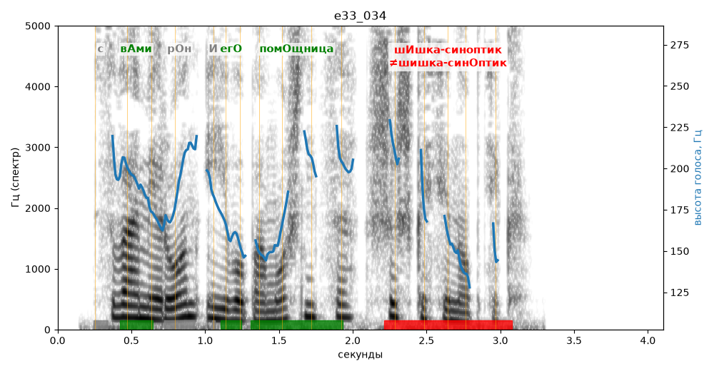

# e33_034

Голос: **edge:ru-RU-SvetlanaNeural** · длительность 4.1 с
Естественность (UTMOS): **3.89 из 5** (живой диктор ≈ 4–4.5)
Эталон: С вами Рон и его помощница — шишка-синоптик.
Распознано: С вами Рон и его помощница – Шишка Синоптик.
Расхождения в словах: «шишка-синоптик» → «шишка синоптик»

## Ударения
(где нужно: ruaccent)

| слово | нужно | у голоса | |
|---|---|---|---|
| вами | вАми | вАми | ✓ |
| его | егО | егО | ✓ |
| помощница | помОщница | помОщница | ✓ |
| шишка-синоптик | шИшка-синоптик | шишка-синОптик | ✗ ОШИБКА |

## Интонация
- ✗ «с вами рон и его помощница шишка-синоптик.» — конец фразы не понижается — звучит незаконченно / как перечисление
- Диапазон голоса 6.9 полутонов (нормально), средняя высота 176 Гц

## Паузы и темп
- паузы на своих местах
- Темп 6.3 слога/с (нормально)

_Синяя линия — высота голоса. Над словами заглавная буква — где ударение должно быть; красным — голос поставил не туда (уверенно), оранжевым — возможно._
