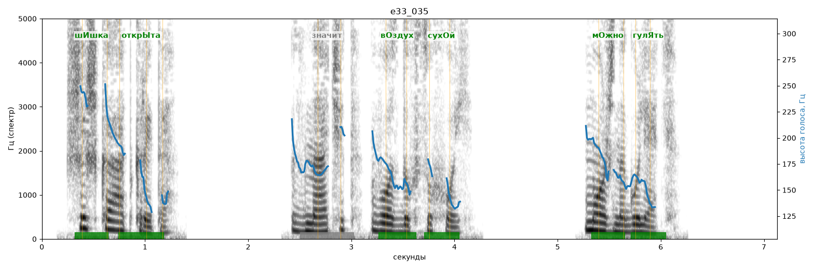

# e33_035

Голос: **edge:ru-RU-SvetlanaNeural** · длительность 7.1 с
Естественность (UTMOS): **3.87 из 5** (живой диктор ≈ 4–4.5)
Эталон: Шишка открыта. Значит, воздух сухой. Можно гулять!
Распознано: Шишка открыта. Значит, воздух сухой. Можно гулять.
Слова: все совпали

## Ударения
(где нужно: ruaccent)

| слово | нужно | у голоса | |
|---|---|---|---|
| шишка | шИшка | шИшка | ✓ |
| открыта | открЫта | открЫта | ✓ |
| значит | значит | знАчит | нет эталона |
| воздух | вОздух | вОздух | ✓ |
| сухой | сухОй | сухОй | ✓ |
| можно | мОжно | мОжно | ✓ |
| гулять | гулЯть | гулЯть | ✓ |

## Интонация
- ✓ «шишка открыта.» — конец фразы понижается — звучит законченно
- ✓ «значит воздух сухой.» — конец фразы понижается — звучит законченно
- ✓ «можно гулять!» — выделено слово «можно» (+3.1 пт)
- Диапазон голоса 8.5 полутонов (живо), средняя высота 167 Гц

## Паузы и темп
- паузы на своих местах
- Темп 5.2 слога/с (нормально)

_Синяя линия — высота голоса. Над словами заглавная буква — где ударение должно быть; красным — голос поставил не туда (уверенно), оранжевым — возможно._
