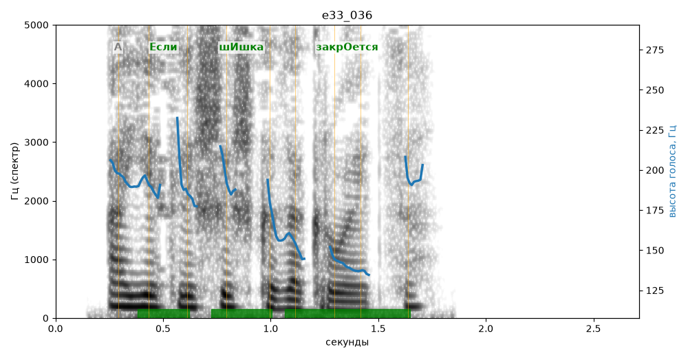

# e33_036

Голос: **edge:ru-RU-SvetlanaNeural** · длительность 2.7 с
Естественность (UTMOS): **3.9 из 5** (живой диктор ≈ 4–4.5)
Эталон: А если шишка закроется?
Распознано: А если шишка закроется?
Слова: все совпали

## Ударения
(где нужно: ruaccent)

| слово | нужно | у голоса | |
|---|---|---|---|
| если | Если | Если | ✓ |
| шишка | шИшка | шИшка | ✓ |
| закроется | закрОется | закрОется | ✓ |

## Интонация
- ✗ «а если шишка закроется?» — нет вопросительного подъёма (самое высокое место — «а», в начале) — звучит как утверждение
- Диапазон голоса 7.2 полутонов (живо), средняя высота 186 Гц

## Паузы и темп
- паузы на своих местах
- Темп 6.6 слога/с (быстро)

_Синяя линия — высота голоса. Над словами заглавная буква — где ударение должно быть; красным — голос поставил не туда (уверенно), оранжевым — возможно._
