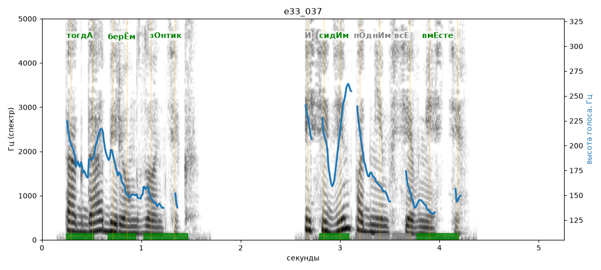

# e33_037

Голос: **edge:ru-RU-SvetlanaNeural** · длительность 5.3 с
Естественность (UTMOS): **4.11 из 5** (живой диктор ≈ 4–4.5)
Эталон: Тогда берём зонтик. И сидим под ним все вместе.
Распознано: Тогда берем зонтик. И сидим под ним все вместе.
Слова: все совпали

## Ударения
(где нужно: ruaccent)

| слово | нужно | у голоса | |
|---|---|---|---|
| тогда | тогдА | тогдА | ✓ |
| берём | берЁм | берЁм | ✓ |
| зонтик | зОнтик | зОнтик | ✓ |
| сидим | сидИм | сидИм | ✓ |
| вместе | вмЕсте | вмЕсте | ✓ |

## Интонация
- ✓ «тогда берём зонтик.» — конец фразы понижается — звучит законченно
- ✓ «и сидим под ним все вместе.» — конец фразы понижается — звучит законченно
- Диапазон голоса 9.5 полутонов (живо), средняя высота 168 Гц

## Паузы и темп
- паузы на своих местах
- Темп 5.1 слога/с (нормально)

_Синяя линия — высота голоса. Над словами заглавная буква — где ударение должно быть; красным — голос поставил не туда (уверенно), оранжевым — возможно._
