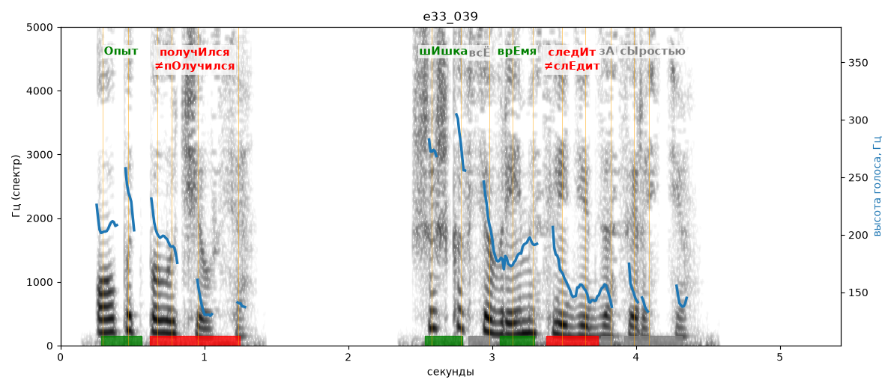

# e33_039

Голос: **edge:ru-RU-SvetlanaNeural** · длительность 5.4 с
Естественность (UTMOS): **3.78 из 5** (живой диктор ≈ 4–4.5)
Эталон: Опыт получился. Шишка всё время следит за сыростью.
Распознано: опыт получился шишка всё время следит за сыростью
Слова: все совпали

## Ударения
(где нужно: ruaccent)

| слово | нужно | у голоса | |
|---|---|---|---|
| опыт | Опыт | Опыт | ✓ |
| получился | получИлся | пОлучился | ✗ ОШИБКА |
| шишка | шИшка | шИшка | ✓ |
| время | врЕмя | врЕмя | ✓ |
| следит | следИт | слЕдит | ✗ ОШИБКА |
| сыростью | сЫростью | — | ? |

## Интонация
- ✓ «опыт получился.» — конец фразы понижается — звучит законченно
- ✓ «шишка всё время следит за сыростью.» — конец фразы понижается — звучит законченно
- Диапазон голоса 11.9 полутонов (живо), средняя высота 178 Гц

## Паузы и темп
- паузы на своих местах
- Темп 5.8 слога/с (нормально)

_Синяя линия — высота голоса. Над словами заглавная буква — где ударение должно быть; красным — голос поставил не туда (уверенно), оранжевым — возможно._
