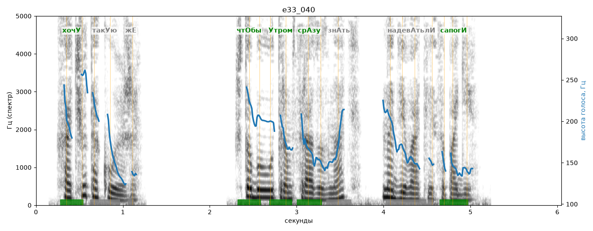

# e33_040

Голос: **edge:ru-RU-SvetlanaNeural** · длительность 6.0 с
Естественность (UTMOS): **3.85 из 5** (живой диктор ≈ 4–4.5)
Эталон: Хочу такую же. Чтобы утром сразу знать, надевать ли сапоги.
Распознано: Хочу такое же, чтобы утром сразу знать надеватель сапоги.
Расхождения в словах: «такую» → «такое»; «надевать ли» → «надеватель»

## Ударения
(где нужно: ruaccent)

| слово | нужно | у голоса | |
|---|---|---|---|
| хочу | хочУ | хочУ | ✓ |
| такую | такУю | — | ? |
| чтобы | чтОбы | чтОбы | ✓ |
| утром | Утром | Утром | ✓ |
| сразу | срАзу | срАзу | ✓ |
| надевать | надевАть | нАдевать | ? не разобрать |
| сапоги | сапогИ | сапогИ | ✓ |

## Интонация
- ✓ «хочу такую же.» — конец фразы понижается — звучит законченно
- ✓ «чтобы утром сразу знать надевать ли сапоги.» — конец фразы понижается — звучит законченно
- Диапазон голоса 9.4 полутонов (живо), средняя высота 166 Гц

## Паузы и темп
- паузы на своих местах
- Темп 6.2 слога/с (нормально)

_Синяя линия — высота голоса. Над словами заглавная буква — где ударение должно быть; красным — голос поставил не туда (уверенно), оранжевым — возможно._
