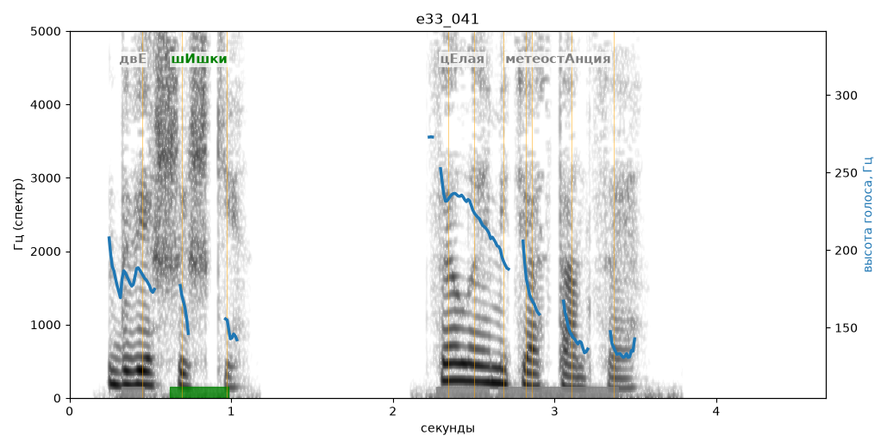

# e33_041

Голос: **edge:ru-RU-SvetlanaNeural** · длительность 4.7 с
Естественность (UTMOS): **3.94 из 5** (живой диктор ≈ 4–4.5)
Эталон: Две шишки! Целая метеостанция!
Распознано: 2 шишки целая метеостанция
Расхождения в словах: «две» → «2»

## Ударения
(где нужно: ruaccent)

| слово | нужно | у голоса | |
|---|---|---|---|
| шишки | шИшки | шИшки | ✓ |
| целая | цЕлая | — | ? |
| метеостанция | метеостАнция | — | ? |

## Интонация
- ✗ «две шишки!» — восклицание звучит ровно, без эмоции
- ✓ «целая метеостанция!» — выделено слово «целая» (+4.0 пт)
- Диапазон голоса 9.9 полутонов (живо), средняя высота 181 Гц

## Паузы и темп
- паузы на своих местах
- Темп 6.1 слога/с (нормально)

_Синяя линия — высота голоса. Над словами заглавная буква — где ударение должно быть; красным — голос поставил не туда (уверенно), оранжевым — возможно._
