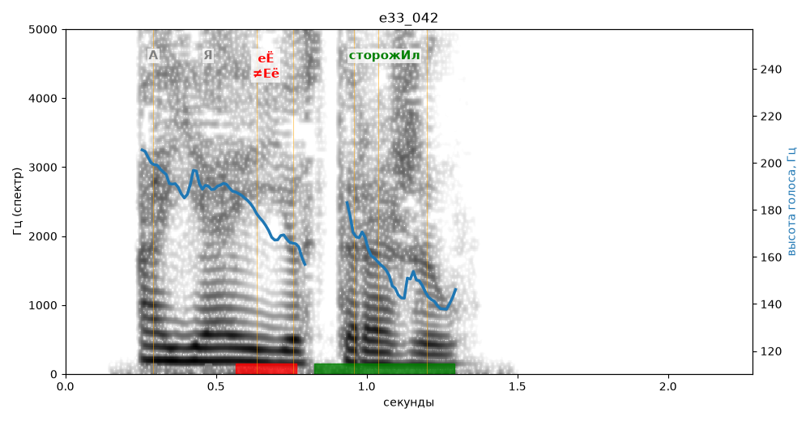

# e33_042

Голос: **edge:ru-RU-SvetlanaNeural** · длительность 2.3 с
Естественность (UTMOS): **3.79 из 5** (живой диктор ≈ 4–4.5)
Эталон: А я её сторожил!
Распознано: А я её сторожил.
Слова: все совпали

## Ударения
(где нужно: ruaccent)

| слово | нужно | у голоса | |
|---|---|---|---|
| её | еЁ | Её | ✗ ОШИБКА |
| сторожил | сторожИл | сторожИл | ✓ |

## Интонация
- ✓ «а я её сторожил!» — выделено слово «а» (+2.6 пт)
- Диапазон голоса 6.0 полутонов (нормально), средняя высота 171 Гц

## Паузы и темп
- паузы на своих местах
- Темп 7.1 слога/с (быстро)

_Синяя линия — высота голоса. Над словами заглавная буква — где ударение должно быть; красным — голос поставил не туда (уверенно), оранжевым — возможно._
