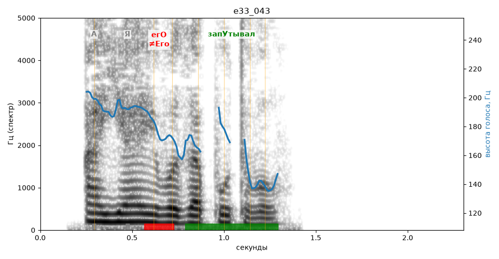

# e33_043

Голос: **edge:ru-RU-SvetlanaNeural** · длительность 2.3 с
Естественность (UTMOS): **4.08 из 5** (живой диктор ≈ 4–4.5)
Эталон: А я его запутывал!
Распознано: А я его запутывал.
Слова: все совпали

## Ударения
(где нужно: ruaccent)

| слово | нужно | у голоса | |
|---|---|---|---|
| его | егО | Его | ✗ ОШИБКА |
| запутывал | запУтывал | запУтывал | ✓ |

## Интонация
- ✓ «а я его запутывал!» — выделено слово «а» (+2.3 пт)
- Диапазон голоса 6.5 полутонов (нормально), средняя высота 175 Гц

## Паузы и темп
- паузы на своих местах
- Темп 8.2 слога/с (быстро)

_Синяя линия — высота голоса. Над словами заглавная буква — где ударение должно быть; красным — голос поставил не туда (уверенно), оранжевым — возможно._
