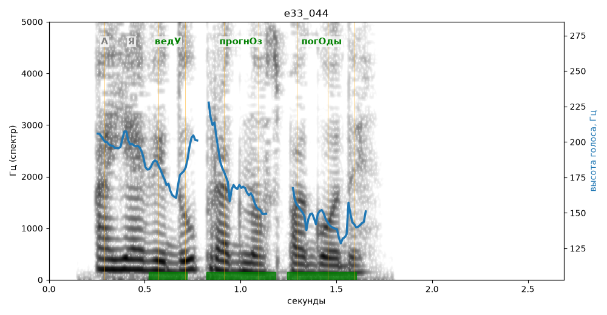

# e33_044

Голос: **edge:ru-RU-SvetlanaNeural** · длительность 2.7 с
Естественность (UTMOS): **3.91 из 5** (живой диктор ≈ 4–4.5)
Эталон: А я веду прогноз погоды!
Распознано: А я веду прогноз погоды.
Слова: все совпали

## Ударения
(где нужно: ruaccent)

| слово | нужно | у голоса | |
|---|---|---|---|
| веду | ведУ | ведУ | ✓ |
| прогноз | прогнОз | прогнОз | ✓ |
| погоды | погОды | погОды | ✓ |

## Интонация
- ✓ «а я веду прогноз погоды!» — выделено слово «а» (+2.9 пт)
- Диапазон голоса 6.9 полутонов (нормально), средняя высота 170 Гц

## Паузы и темп
- паузы на своих местах
- Темп 6.0 слога/с (нормально)

_Синяя линия — высота голоса. Над словами заглавная буква — где ударение должно быть; красным — голос поставил не туда (уверенно), оранжевым — возможно._
