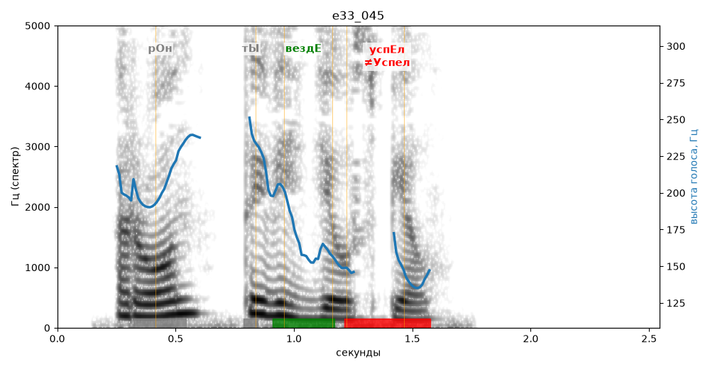

# e33_045

Голос: **edge:ru-RU-SvetlanaNeural** · длительность 2.5 с
Естественность (UTMOS): **3.84 из 5** (живой диктор ≈ 4–4.5)
Эталон: Рон, ты везде успел.
Распознано: Рон, ты везде успел.
Слова: все совпали

## Ударения
(где нужно: ruaccent)

| слово | нужно | у голоса | |
|---|---|---|---|
| везде | вездЕ | вездЕ | ✓ |
| успел | успЕл | Успел | ✗ ОШИБКА |

## Интонация
- ✓ «рон ты везде успел.» — конец фразы понижается — звучит законченно
- Диапазон голоса 9.5 полутонов (живо), средняя высота 192 Гц

## Паузы и темп
- паузы на своих местах
- Темп 5.9 слога/с (нормально)

_Синяя линия — высота голоса. Над словами заглавная буква — где ударение должно быть; красным — голос поставил не туда (уверенно), оранжевым — возможно._
