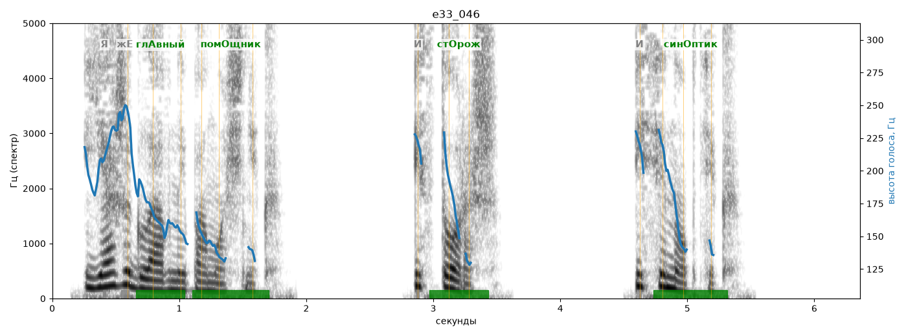

# e33_046

Голос: **edge:ru-RU-SvetlanaNeural** · длительность 6.4 с
Естественность (UTMOS): **3.99 из 5** (живой диктор ≈ 4–4.5)
Эталон: Я же главный помощник. И сторож. И синоптик.
Распознано: Я же главный помощник. Исторож. И синоптик.
Расхождения в словах: «и сторож» → «исторож»

## Ударения
(где нужно: ruaccent)

| слово | нужно | у голоса | |
|---|---|---|---|
| главный | глАвный | глАвный | ✓ |
| помощник | помОщник | помОщник | ✓ |
| сторож | стОрож | стОрож | ✓ |
| синоптик | синОптик | синОптик | ✓ |

## Интонация
- ✓ «я же главный помощник.» — конец фразы понижается — звучит законченно
- ✗ «и сторож.» — конец фразы не понижается — звучит незаконченно / как перечисление
- ✓ «и синоптик.» — конец фразы понижается — звучит законченно
- Диапазон голоса 9.9 полутонов (живо), средняя высота 176 Гц

## Паузы и темп
- паузы на своих местах
- Темп 5.1 слога/с (нормально)

_Синяя линия — высота голоса. Над словами заглавная буква — где ударение должно быть; красным — голос поставил не туда (уверенно), оранжевым — возможно._
