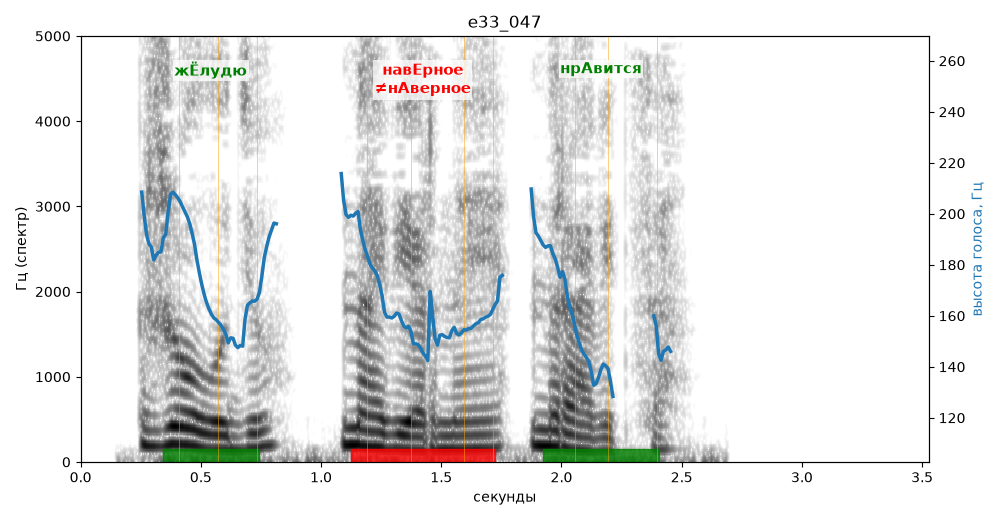

# e33_047

Голос: **edge:ru-RU-SvetlanaNeural** · длительность 3.5 с
Естественность (UTMOS): **3.62 из 5** (живой диктор ≈ 4–4.5)
Эталон: Жёлудю, наверное, нравится.
Распознано: Желудью, наверное, нравится.
Расхождения в словах: «желудю» → «желудью»

## Ударения
(где нужно: ruaccent)

| слово | нужно | у голоса | |
|---|---|---|---|
| жёлудю | жЁлудю | жЁлудю | ✓ |
| наверное | навЕрное | нАверное | ✗ ОШИБКА |
| нравится | нрАвится | нрАвится | ✓ |

## Интонация
- ✗ «жёлудю наверное нравится.» — конец фразы не понижается — звучит незаконченно / как перечисление
- Диапазон голоса 6.4 полутонов (нормально), средняя высота 161 Гц

## Паузы и темп
- паузы на своих местах
- Темп 6.7 слога/с (быстро)

_Синяя линия — высота голоса. Над словами заглавная буква — где ударение должно быть; красным — голос поставил не туда (уверенно), оранжевым — возможно._
