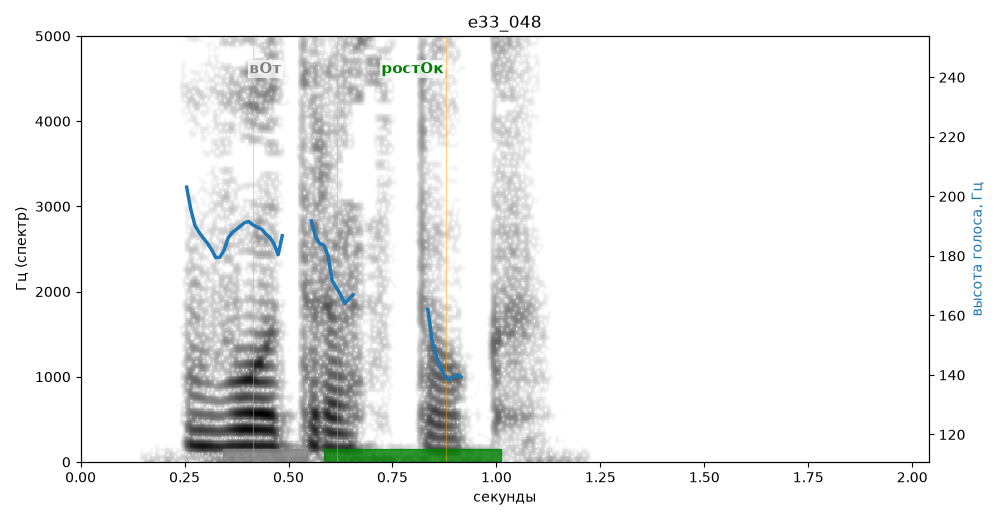

# e33_048

Голос: **edge:ru-RU-SvetlanaNeural** · длительность 2.0 с
Естественность (UTMOS): **3.65 из 5** (живой диктор ≈ 4–4.5)
Эталон: Вот росток!
Распознано: Вот расток.
Расхождения в словах: «росток» → «расток»

## Ударения
(где нужно: ruaccent)

| слово | нужно | у голоса | |
|---|---|---|---|
| росток | ростОк | ростОк | ✓ |

## Интонация
- ✗ «вот росток!» — восклицание звучит ровно, без эмоции
- Диапазон голоса 5.5 полутонов (нормально), средняя высота 184 Гц

## Паузы и темп
- паузы на своих местах
- Темп 4.5 слога/с (нормально)

_Синяя линия — высота голоса. Над словами заглавная буква — где ударение должно быть; красным — голос поставил не туда (уверенно), оранжевым — возможно._
