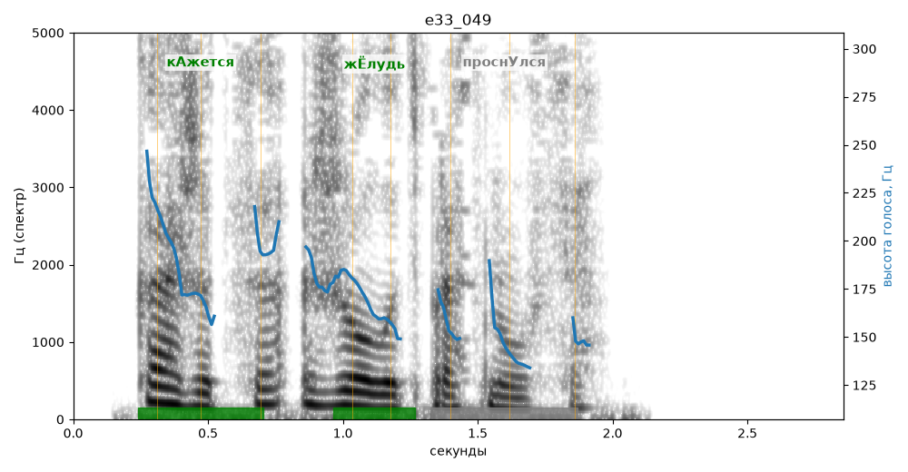

# e33_049

Голос: **edge:ru-RU-SvetlanaNeural** · длительность 2.9 с
Естественность (UTMOS): **3.48 из 5** (живой диктор ≈ 4–4.5)
Эталон: Кажется, жёлудь проснулся!
Распознано: Кажется, желать проснулся.
Расхождения в словах: «желудь» → «желать»

## Ударения
(где нужно: ruaccent)

| слово | нужно | у голоса | |
|---|---|---|---|
| кажется | кАжется | кАжется | ✓ |
| жёлудь | жЁлудь | жЁлудь | ✓ |
| проснулся | проснУлся | проснулсЯ | ? не разобрать |

## Интонация
- ✓ «кажется жёлудь проснулся!» — выделено слово «кажется» (+4.2 пт)
- Диапазон голоса 7.8 полутонов (живо), средняя высота 172 Гц

## Паузы и темп
- паузы на своих местах
- Темп 5.8 слога/с (нормально)

_Синяя линия — высота голоса. Над словами заглавная буква — где ударение должно быть; красным — голос поставил не туда (уверенно), оранжевым — возможно._
