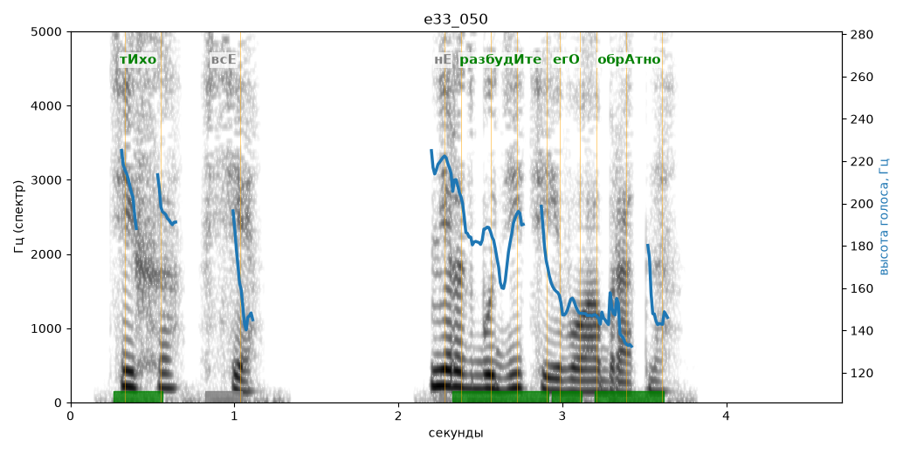

# e33_050

Голос: **edge:ru-RU-SvetlanaNeural** · длительность 4.7 с
Естественность (UTMOS): **3.88 из 5** (живой диктор ≈ 4–4.5)
Эталон: Тихо, все. Не разбудите его обратно.
Распознано: Тихо, все. Не разбудите его обратно.
Слова: все совпали

## Ударения
(где нужно: ruaccent)

| слово | нужно | у голоса | |
|---|---|---|---|
| тихо | тИхо | тИхо | ✓ |
| разбудите | разбудИте | разбудИте | ✓ |
| его | егО | егО | ✓ |
| обратно | обрАтно | обрАтно | ✓ |

## Интонация
- ✓ «тихо все.» — конец фразы понижается — звучит законченно
- ✓ «не разбудите его обратно.» — конец фразы понижается — звучит законченно
- Диапазон голоса 7.7 полутонов (живо), средняя высота 174 Гц

## Паузы и темп
- паузы на своих местах
- Темп 6.9 слога/с (быстро)

_Синяя линия — высота голоса. Над словами заглавная буква — где ударение должно быть; красным — голос поставил не туда (уверенно), оранжевым — возможно._
