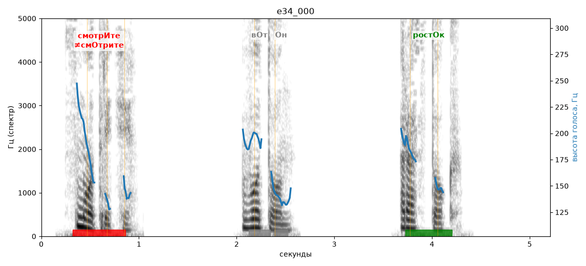

# e34_000

Голос: **edge:ru-RU-SvetlanaNeural** · длительность 5.2 с
Естественность (UTMOS): **3.78 из 5** (живой диктор ≈ 4–4.5)
Эталон: Смотрите! Вот он! Росток!
Распознано: Смотрите. Вот он. Росток.
Слова: все совпали

## Ударения
(где нужно: ruaccent)

| слово | нужно | у голоса | |
|---|---|---|---|
| смотрите | смотрИте | смОтрите | ✗ ОШИБКА |
| росток | ростОк | ростОк | ✓ |

## Интонация
- ✗ «смотрите!» — восклицание звучит ровно, без эмоции
- Диапазон голоса 8.3 полутонов (живо), средняя высота 173 Гц

## Паузы и темп
- паузы на своих местах
- Темп 4.9 слога/с (нормально)

_Синяя линия — высота голоса. Над словами заглавная буква — где ударение должно быть; красным — голос поставил не туда (уверенно), оранжевым — возможно._
