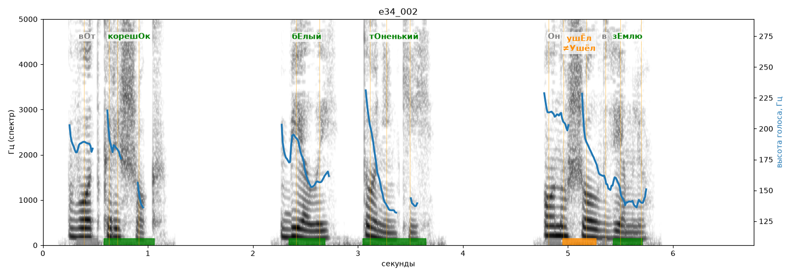

# e34_002

Голос: **edge:ru-RU-SvetlanaNeural** · длительность 6.8 с
Естественность (UTMOS): **4.0 из 5** (живой диктор ≈ 4–4.5)
Эталон: Вот корешок. Белый, тоненький. Он ушёл в землю.
Распознано: Вот крешок. Белый, тоненький. Он ушел в землю.
Расхождения в словах: «корешок» → «крешок»

## Ударения
(где нужно: ruaccent)

| слово | нужно | у голоса | |
|---|---|---|---|
| корешок | корешОк | корешОк | ✓ |
| белый | бЕлый | бЕлый | ✓ |
| тоненький | тОненький | тОненький | ✓ |
| ушёл | ушЁл | Ушёл | ✗? возможно — послушать |
| землю | зЕмлю | зЕмлю | ✓ |

## Интонация
- ✓ «вот корешок.» — конец фразы понижается — звучит законченно
- ✗ «белый тоненький.» — конец фразы не понижается — звучит незаконченно / как перечисление
- ✓ «он ушёл в землю.» — конец фразы понижается — звучит законченно
- Диапазон голоса 7.7 полутонов (живо), средняя высота 173 Гц

## Паузы и темп
- паузы на своих местах
- Темп 5.8 слога/с (нормально)

_Синяя линия — высота голоса. Над словами заглавная буква — где ударение должно быть; красным — голос поставил не туда (уверенно), оранжевым — возможно._
