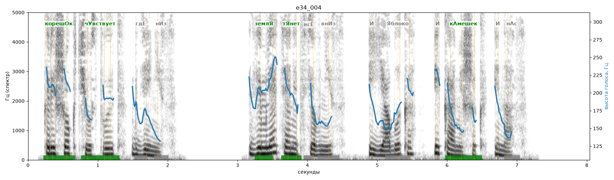

# e34_004

Голос: **edge:ru-RU-SvetlanaNeural** · длительность 8.0 с
Естественность (UTMOS): **4.01 из 5** (живой диктор ≈ 4–4.5)
Эталон: Корешок чувствует, где низ. Земля тянет всё вниз — и яблоко, и камешек, и нас.
Распознано: Корешок чувствует, где низ. Земля тянет всё вниз, и яблоко, и камешек, и нас.
Слова: все совпали

## Ударения
(где нужно: ruaccent)

| слово | нужно | у голоса | |
|---|---|---|---|
| корешок | корешОк | корешОк | ✓ |
| чувствует | чУвствует | чУвствует | ✓ |
| земля | землЯ | землЯ | ✓ |
| тянет | тЯнет | тЯнет | ✓ |
| яблоко | Яблоко | — | ? |
| камешек | кАмешек | кАмешек | ✓ |

## Интонация
- ✓ «корешок чувствует где низ.» — конец фразы понижается — звучит законченно
- ✓ «земля тянет всё вниз и яблоко и камешек и нас.» — конец фразы понижается — звучит законченно
- Диапазон голоса 8.2 полутонов (живо), средняя высота 179 Гц

## Паузы и темп
- паузы на своих местах
- Темп 5.6 слога/с (нормально)

_Синяя линия — высота голоса. Над словами заглавная буква — где ударение должно быть; красным — голос поставил не туда (уверенно), оранжевым — возможно._
