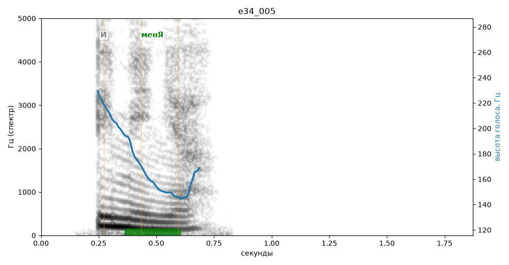

# e34_005

Голос: **edge:ru-RU-SvetlanaNeural** · длительность 1.9 с
Естественность (UTMOS): **3.61 из 5** (живой диктор ≈ 4–4.5)
Эталон: И меня?
Распознано: И меня.
Слова: все совпали

## Ударения
(где нужно: ruaccent)

| слово | нужно | у голоса | |
|---|---|---|---|
| меня | менЯ | менЯ | ✓ |

## Интонация
- ✓ «и меня?» — вопросительный подъём на слове «и»
- Диапазон голоса 7.1 полутонов (живо), средняя высота 166 Гц

## Паузы и темп
- паузы на своих местах
- Темп 8.8 слога/с (быстро)

_Синяя линия — высота голоса. Над словами заглавная буква — где ударение должно быть; красным — голос поставил не туда (уверенно), оранжевым — возможно._
