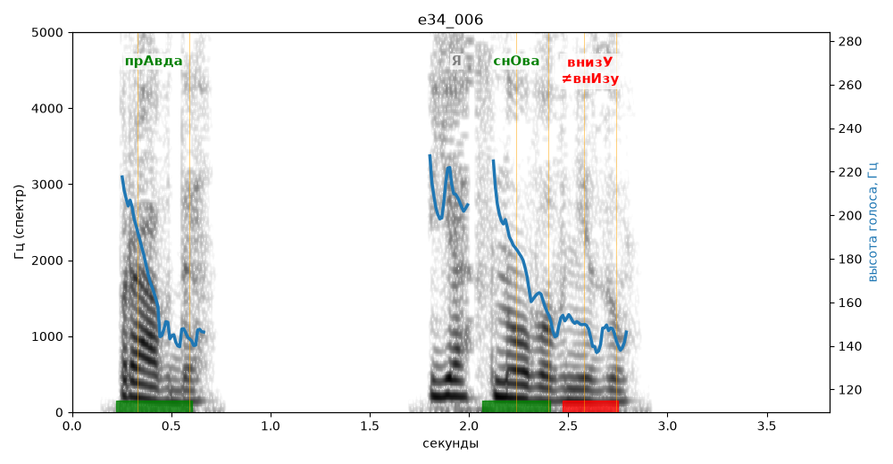

# e34_006

Голос: **edge:ru-RU-SvetlanaNeural** · длительность 3.8 с
Естественность (UTMOS): **3.78 из 5** (живой диктор ≈ 4–4.5)
Эталон: Правда! Я снова внизу.
Распознано: Правда. Я снова внизу.
Слова: все совпали

## Ударения
(где нужно: ruaccent)

| слово | нужно | у голоса | |
|---|---|---|---|
| правда | прАвда | прАвда | ✓ |
| снова | снОва | снОва | ✓ |
| внизу | внизУ | внИзу | ✗ ОШИБКА |

## Интонация
- ✓ «я снова внизу.» — конец фразы понижается — звучит законченно
- Диапазон голоса 7.4 полутонов (живо), средняя высота 158 Гц

## Паузы и темп
- паузы на своих местах
- Темп 5.0 слога/с (нормально)

_Синяя линия — высота голоса. Над словами заглавная буква — где ударение должно быть; красным — голос поставил не туда (уверенно), оранжевым — возможно._
