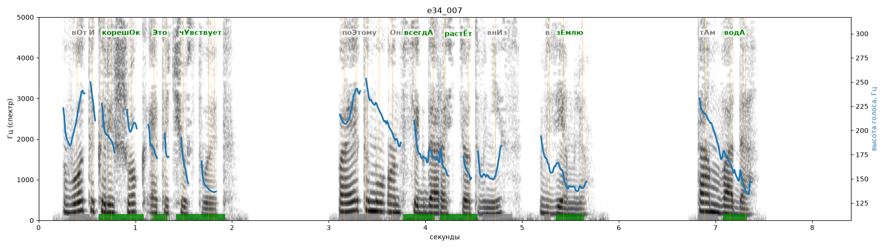

# e34_007

Голос: **edge:ru-RU-SvetlanaNeural** · длительность 8.4 с
Естественность (UTMOS): **3.81 из 5** (живой диктор ≈ 4–4.5)
Эталон: Вот и корешок это чувствует. Поэтому он всегда растёт вниз, в землю. Там вода.
Распознано: Вот и крешок это чувствует. Поэтому он всегда растет вниз, в землю. Там вода.
Расхождения в словах: «корешок» → «крешок»

## Ударения
(где нужно: ruaccent)

| слово | нужно | у голоса | |
|---|---|---|---|
| корешок | корешОк | корешОк | ✓ |
| это | Это | Это | ✓ |
| чувствует | чУвствует | чУвствует | ✓ |
| поэтому | поЭтому | поэтОму | ? не разобрать |
| всегда | всегдА | всегдА | ✓ |
| растёт | растЁт | растЁт | ✓ |
| землю | зЕмлю | зЕмлю | ✓ |
| вода | водА | водА | ✓ |

## Интонация
- ✓ «вот и корешок это чувствует.» — конец фразы понижается — звучит законченно
- ✓ «поэтому он всегда растёт вниз в землю.» — конец фразы понижается — звучит законченно
- ✓ «там вода.» — конец фразы понижается — звучит законченно
- Диапазон голоса 9.0 полутонов (живо), средняя высота 176 Гц

## Паузы и темп
- паузы на своих местах
- Темп 6.1 слога/с (нормально)

_Синяя линия — высота голоса. Над словами заглавная буква — где ударение должно быть; красным — голос поставил не туда (уверенно), оранжевым — возможно._
