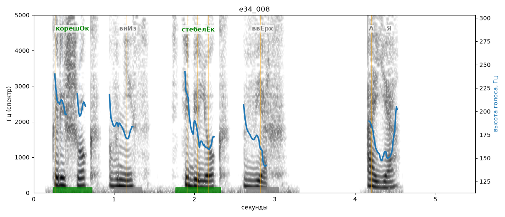

# e34_008

Голос: **edge:ru-RU-SvetlanaNeural** · длительность 5.5 с
Естественность (UTMOS): **3.85 из 5** (живой диктор ≈ 4–4.5)
Эталон: Корешок — вниз, стебелёк — вверх. А я?
Распознано: Кришок вниз, стебелек вверх. А я?
Расхождения в словах: «корешок» → «кришок»

## Ударения
(где нужно: ruaccent)

| слово | нужно | у голоса | |
|---|---|---|---|
| корешок | корешОк | корешОк | ✓ |
| стебелёк | стебелЁк | стебелЁк | ✓ |

## Интонация
- ✓ «корешок вниз стебелёк вверх.» — конец фразы понижается — звучит законченно
- Диапазон голоса 6.5 полутонов (нормально), средняя высота 178 Гц

## Паузы и темп
- паузы на своих местах
- Темп 4.9 слога/с (нормально)

_Синяя линия — высота голоса. Над словами заглавная буква — где ударение должно быть; красным — голос поставил не туда (уверенно), оранжевым — возможно._
