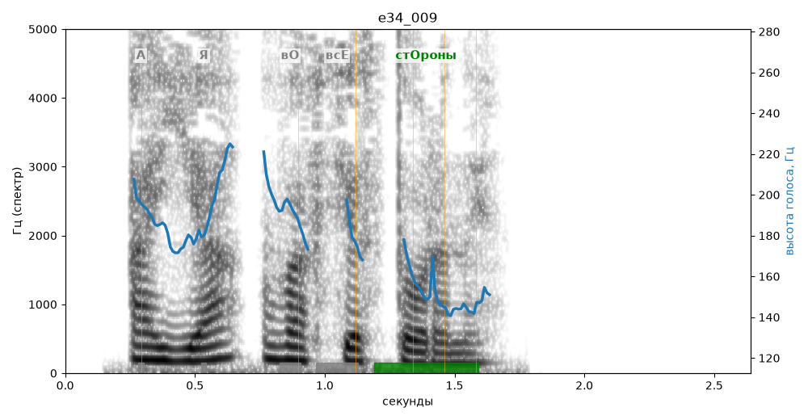

# e34_009

Голос: **edge:ru-RU-SvetlanaNeural** · длительность 2.6 с
Естественность (UTMOS): **3.98 из 5** (живой диктор ≈ 4–4.5)
Эталон: А я — во все стороны!
Распознано: А я во все стороны.
Слова: все совпали

## Ударения
(где нужно: ruaccent)

| слово | нужно | у голоса | |
|---|---|---|---|
| стороны | стОроны | стОроны | ✓ |

## Интонация
- ✓ «а я во все стороны!» — выделено слово «во» (+2.5 пт)
- Диапазон голоса 6.8 полутонов (нормально), средняя высота 179 Гц

## Паузы и темп
- паузы на своих местах
- Темп 7.4 слога/с (быстро)

_Синяя линия — высота голоса. Над словами заглавная буква — где ударение должно быть; красным — голос поставил не туда (уверенно), оранжевым — возможно._
