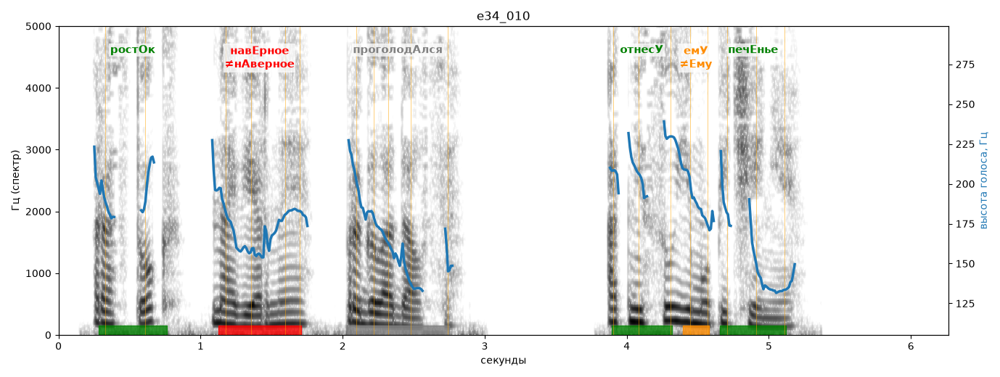

# e34_010

Голос: **edge:ru-RU-SvetlanaNeural** · длительность 6.3 с
Естественность (UTMOS): **3.99 из 5** (живой диктор ≈ 4–4.5)
Эталон: Росток, наверное, проголодался. Отнесу ему печенье!
Распознано: Росток, наверное, проголодался. Отнесу ему печенье.
Слова: все совпали

## Ударения
(где нужно: ruaccent)

| слово | нужно | у голоса | |
|---|---|---|---|
| росток | ростОк | ростОк | ✓ |
| наверное | навЕрное | нАверное | ✗ ОШИБКА |
| проголодался | проголодАлся | проголодалсЯ | ? не разобрать |
| отнесу | отнесУ | отнесУ | ✓ |
| ему | емУ | Ему | ✗? возможно — послушать |
| печенье | печЕнье | печЕнье | ✓ |

## Интонация
- ✓ «росток наверное проголодался.» — конец фразы понижается — звучит законченно
- ✓ «отнесу ему печенье!» — выделено слово «отнесу» (+2.9 пт)
- Диапазон голоса 8.9 полутонов (живо), средняя высота 179 Гц

## Паузы и темп
- паузы на своих местах
- Темп 6.3 слога/с (нормально)

_Синяя линия — высота голоса. Над словами заглавная буква — где ударение должно быть; красным — голос поставил не туда (уверенно), оранжевым — возможно._
