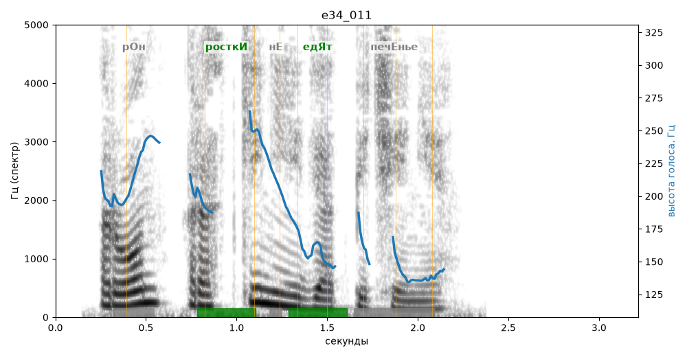

# e34_011

Голос: **edge:ru-RU-SvetlanaNeural** · длительность 3.2 с
Естественность (UTMOS): **4.06 из 5** (живой диктор ≈ 4–4.5)
Эталон: Рон, ростки не едят печенье.
Распознано: Рон, растки не едят печенье.
Расхождения в словах: «ростки» → «растки»

## Ударения
(где нужно: ruaccent)

| слово | нужно | у голоса | |
|---|---|---|---|
| ростки | росткИ | росткИ | ✓ |
| едят | едЯт | едЯт | ✓ |
| печенье | печЕнье | печеньЕ | ? не разобрать |

## Интонация
- ✓ «рон ростки не едят печенье.» — конец фразы понижается — звучит законченно
- Диапазон голоса 10.3 полутонов (живо), средняя высота 189 Гц

## Паузы и темп
- паузы на своих местах
- Темп 5.9 слога/с (нормально)

_Синяя линия — высота голоса. Над словами заглавная буква — где ударение должно быть; красным — голос поставил не туда (уверенно), оранжевым — возможно._
