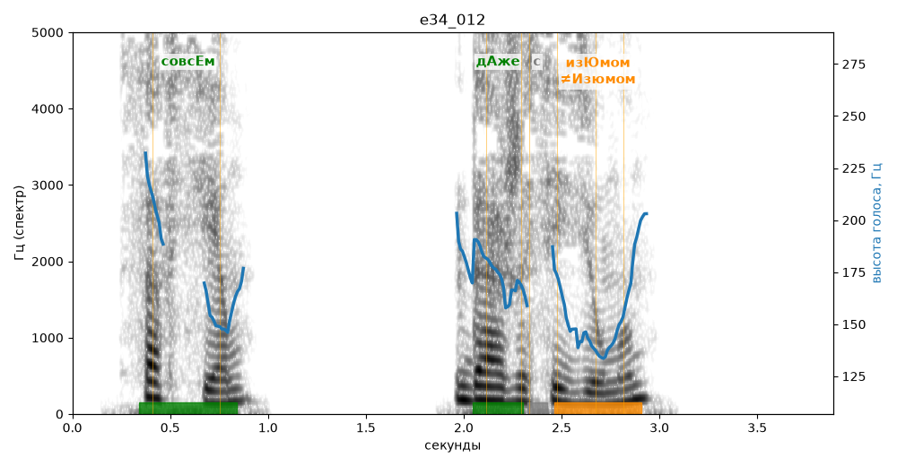

# e34_012

Голос: **edge:ru-RU-SvetlanaNeural** · длительность 3.9 с
Естественность (UTMOS): **3.92 из 5** (живой диктор ≈ 4–4.5)
Эталон: Совсем? Даже с изюмом?
Распознано: Совсем. Даже с изюмом.
Слова: все совпали

## Ударения
(где нужно: ruaccent)

| слово | нужно | у голоса | |
|---|---|---|---|
| совсем | совсЕм | совсЕм | ✓ |
| даже | дАже | дАже | ✓ |
| изюмом | изЮмом | Изюмом | ✗? возможно — послушать |

## Интонация
- ✗ «даже с изюмом?» — нет вопросительного подъёма (самое высокое место — «даже», в начале) — звучит как утверждение
- Диапазон голоса 6.8 полутонов (нормально), средняя высота 166 Гц

## Паузы и темп
- паузы на своих местах
- Темп 5.9 слога/с (нормально)

_Синяя линия — высота голоса. Над словами заглавная буква — где ударение должно быть; красным — голос поставил не туда (уверенно), оранжевым — возможно._
