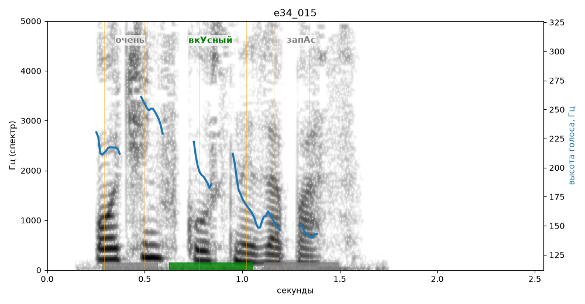

# e34_015

Голос: **edge:ru-RU-SvetlanaNeural** · длительность 2.5 с
Естественность (UTMOS): **4.22 из 5** (живой диктор ≈ 4–4.5)
Эталон: Очень вкусный запас.
Распознано: Очень вкусный запас!
Слова: все совпали

## Ударения
(где нужно: ruaccent)

| слово | нужно | у голоса | |
|---|---|---|---|
| очень | очень | Очень | нет эталона |
| вкусный | вкУсный | вкУсный | ✓ |
| запас | запАс | зАпас | ? не разобрать |

## Интонация
- ✓ «очень вкусный запас.» — конец фразы понижается — звучит законченно
- Диапазон голоса 9.8 полутонов (живо), средняя высота 190 Гц

## Паузы и темп
- паузы на своих местах
- Темп 5.0 слога/с (нормально)

_Синяя линия — высота голоса. Над словами заглавная буква — где ударение должно быть; красным — голос поставил не туда (уверенно), оранжевым — возможно._
