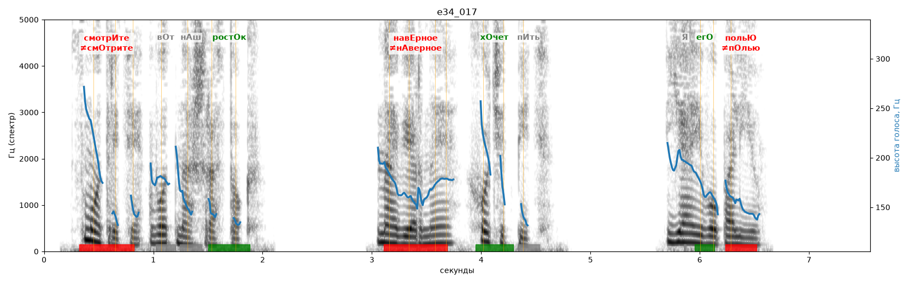

# e34_017

Голос: **edge:ru-RU-SvetlanaNeural** · длительность 7.6 с
Естественность (UTMOS): **3.92 из 5** (живой диктор ≈ 4–4.5)
Эталон: Смотрите, вот наш росток. Наверное, хочет пить. Я его полью!
Распознано: Смотрите, вот наш расток. Наверное, хочет пить. Я его полью.
Расхождения в словах: «росток» → «расток»

## Ударения
(где нужно: ruaccent)

| слово | нужно | у голоса | |
|---|---|---|---|
| смотрите | смотрИте | смОтрите | ✗ ОШИБКА |
| росток | ростОк | ростОк | ✓ |
| наверное | навЕрное | нАверное | ✗ ОШИБКА |
| хочет | хОчет | хОчет | ✓ |
| его | егО | егО | ✓ |
| полью | польЮ | пОлью | ✗ ОШИБКА |

## Интонация
- ✓ «смотрите вот наш росток.» — конец фразы понижается — звучит законченно
- ✓ «наверное хочет пить.» — конец фразы понижается — звучит законченно
- ✗ «я его полью!» — восклицание звучит ровно, без эмоции
- Диапазон голоса 8.0 полутонов (живо), средняя высота 169 Гц

## Паузы и темп
- паузы на своих местах
- Темп 5.3 слога/с (нормально)

_Синяя линия — высота голоса. Над словами заглавная буква — где ударение должно быть; красным — голос поставил не туда (уверенно), оранжевым — возможно._
