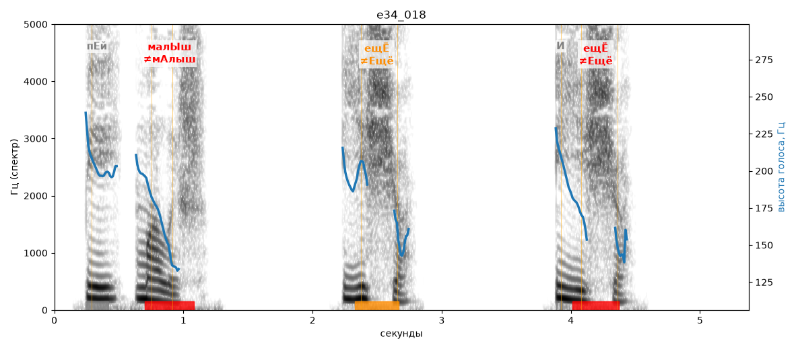

# e34_018

Голос: **edge:ru-RU-SvetlanaNeural** · длительность 5.4 с
Естественность (UTMOS): **4.04 из 5** (живой диктор ≈ 4–4.5)
Эталон: Пей, малыш! Ещё! И ещё!
Распознано: Пей, малыш. Ещё. И ещё.
Слова: все совпали

## Ударения
(где нужно: ruaccent)

| слово | нужно | у голоса | |
|---|---|---|---|
| малыш | малЫш | мАлыш | ✗ ОШИБКА |
| ещё | ещЁ | Ещё | ✗? возможно — послушать |
| ещё | ещЁ | Ещё | ✗ ОШИБКА |

## Интонация
- ✗ «пей малыш!» — восклицание звучит ровно, без эмоции
- ✓ «и ещё!» — выделено слово «и» (+2.8 пт)
- Диапазон голоса 7.6 полутонов (живо), средняя высота 189 Гц

## Паузы и темп
- паузы на своих местах
- Темп 5.9 слога/с (нормально)

_Синяя линия — высота голоса. Над словами заглавная буква — где ударение должно быть; красным — голос поставил не туда (уверенно), оранжевым — возможно._
