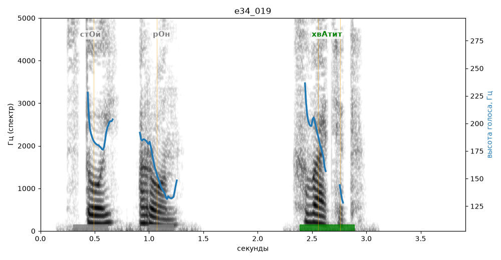

# e34_019

Голос: **edge:ru-RU-SvetlanaNeural** · длительность 3.9 с
Естественность (UTMOS): **3.58 из 5** (живой диктор ≈ 4–4.5)
Эталон: Стой, Рон! Хватит!
Распознано: Стой, Рон. Хватит!
Слова: все совпали

## Ударения
(где нужно: ruaccent)

| слово | нужно | у голоса | |
|---|---|---|---|
| хватит | хвАтит | хвАтит | ✓ |

## Интонация
- Диапазон голоса 7.6 полутонов (живо), средняя высота 181 Гц

## Паузы и темп
- паузы на своих местах
- Темп 3.8 слога/с (медленно)

_Синяя линия — высота голоса. Над словами заглавная буква — где ударение должно быть; красным — голос поставил не туда (уверенно), оранжевым — возможно._
