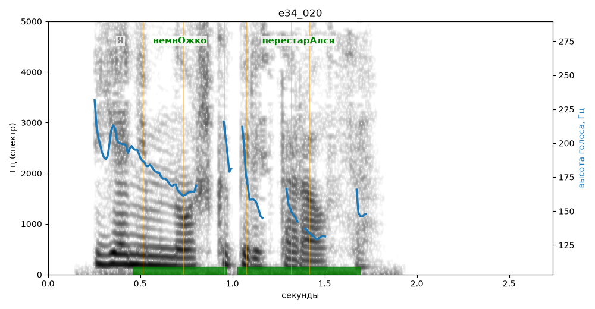

# e34_020

Голос: **edge:ru-RU-SvetlanaNeural** · длительность 2.7 с
Естественность (UTMOS): **3.75 из 5** (живой диктор ≈ 4–4.5)
Эталон: Я немножко перестарался.
Распознано: Я немножко перестарался.
Слова: все совпали

## Ударения
(где нужно: ruaccent)

| слово | нужно | у голоса | |
|---|---|---|---|
| немножко | немнОжко | немнОжко | ✓ |
| перестарался | перестарАлся | перестарАлся | ✓ |

## Интонация
- ✓ «я немножко перестарался.» — конец фразы понижается — звучит законченно
- Диапазон голоса 8.2 полутонов (живо), средняя высота 170 Гц

## Паузы и темп
- паузы на своих местах
- Темп 6.1 слога/с (нормально)

_Синяя линия — высота голоса. Над словами заглавная буква — где ударение должно быть; красным — голос поставил не туда (уверенно), оранжевым — возможно._
