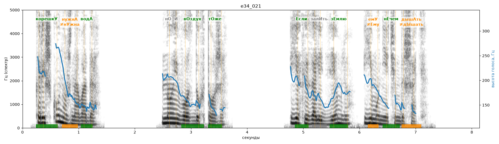

# e34_021

Голос: **edge:ru-RU-SvetlanaNeural** · длительность 8.1 с
Естественность (UTMOS): **3.66 из 5** (живой диктор ≈ 4–4.5)
Эталон: Корешку нужна вода. Но и воздух тоже. Если залить землю, ему нечем дышать.
Распознано: Корешку нужна вода. Но и воздух тоже. Если залить землю, ему нечем дышать.
Слова: все совпали

## Ударения
(где нужно: ruaccent)

| слово | нужно | у голоса | |
|---|---|---|---|
| корешку | корешкУ | корешкУ | ✓ |
| нужна | нужнА | нУжна | ✗? возможно — послушать |
| вода | водА | водА | ✓ |
| воздух | вОздух | вОздух | ✓ |
| тоже | тОже | тОже | ✓ |
| если | Если | Если | ✓ |
| залить | залИть | зАлить | ? не разобрать |
| землю | зЕмлю | зЕмлю | ✓ |
| ему | емУ | Ему | ✗? возможно — послушать |
| нечем | нЕчем | нЕчем | ✓ |
| дышать | дышАть | дЫшать | ✗? возможно — послушать |

## Интонация
- ✓ «корешку нужна вода.» — конец фразы понижается — звучит законченно
- ✓ «но и воздух тоже.» — конец фразы понижается — звучит законченно
- ✓ «если залить землю ему нечем дышать.» — конец фразы понижается — звучит законченно
- Диапазон голоса 7.8 полутонов (живо), средняя высота 168 Гц

## Паузы и темп
- паузы на своих местах
- Темп 6.5 слога/с (нормально)

_Синяя линия — высота голоса. Над словами заглавная буква — где ударение должно быть; красным — голос поставил не туда (уверенно), оранжевым — возможно._
