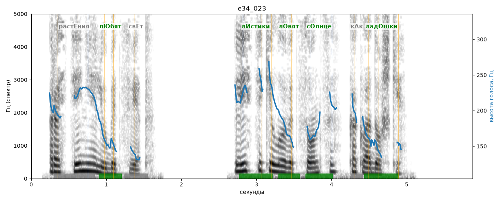

# e34_023

Голос: **edge:ru-RU-SvetlanaNeural** · длительность 5.9 с
Естественность (UTMOS): **3.94 из 5** (живой диктор ≈ 4–4.5)
Эталон: Растения любят свет. Листики ловят солнце, как ладошки.
Распознано: Растение любит цвет. Листики ловят солнце, как ладошки.
Расхождения в словах: «растения любят свет» → «растение любит цвет»

## Ударения
(где нужно: ruaccent)

| слово | нужно | у голоса | |
|---|---|---|---|
| растения | растЕния | — | ? |
| любят | лЮбят | лЮбят | ✓ |
| листики | лИстики | лИстики | ✓ |
| ловят | лОвят | лОвят | ✓ |
| солнце | сОлнце | сОлнце | ✓ |
| ладошки | ладОшки | ладОшки | ✓ |

## Интонация
- ✓ «растения любят свет.» — конец фразы понижается — звучит законченно
- ✓ «листики ловят солнце как ладошки.» — конец фразы понижается — звучит законченно
- Диапазон голоса 8.9 полутонов (живо), средняя высота 191 Гц

## Паузы и темп
- паузы на своих местах
- Темп 5.4 слога/с (нормально)

_Синяя линия — высота голоса. Над словами заглавная буква — где ударение должно быть; красным — голос поставил не туда (уверенно), оранжевым — возможно._
