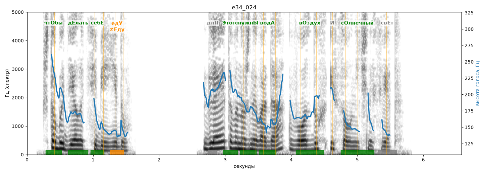

# e34_024

Голос: **edge:ru-RU-SvetlanaNeural** · длительность 6.6 с
Естественность (UTMOS): **3.78 из 5** (живой диктор ≈ 4–4.5)
Эталон: Чтобы делать себе еду. Для этого нужны вода, воздух и солнечный свет.
Распознано: чтобы делать себе еду. Для этого нужны вода, воздух и солнечный свет.
Слова: все совпали

## Ударения
(где нужно: ruaccent)

| слово | нужно | у голоса | |
|---|---|---|---|
| чтобы | чтОбы | чтОбы | ✓ |
| делать | дЕлать | дЕлать | ✓ |
| себе | себЕ | себЕ | ✓ |
| еду | едУ | Еду | ✗? возможно — послушать |
| этого | Этого | Этого | ✓ |
| нужны | нужнЫ | нужнЫ | ✓ |
| вода | водА | водА | ✓ |
| воздух | вОздух | вОздух | ✓ |
| солнечный | сОлнечный | сОлнечный | ✓ |

## Интонация
- ✓ «чтобы делать себе еду.» — конец фразы понижается — звучит законченно
- ✓ «для этого нужны вода воздух и солнечный свет.» — конец фразы понижается — звучит законченно
- Диапазон голоса 8.1 полутонов (живо), средняя высота 167 Гц

## Паузы и темп
- паузы на своих местах
- Темп 6.2 слога/с (нормально)

_Синяя линия — высота голоса. Над словами заглавная буква — где ударение должно быть; красным — голос поставил не туда (уверенно), оранжевым — возможно._
