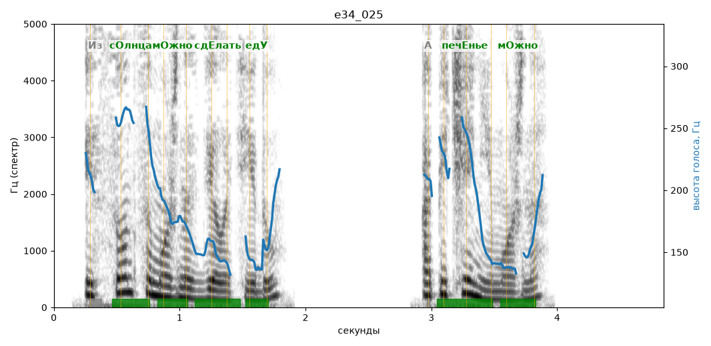

# e34_025

Голос: **edge:ru-RU-SvetlanaNeural** · длительность 4.8 с
Естественность (UTMOS): **4.15 из 5** (живой диктор ≈ 4–4.5)
Эталон: Из солнца можно сделать еду? А печенье можно?
Распознано: Из солнца можно сделать еду. О печении можно.
Расхождения в словах: «а печенье» → «о печении»

## Ударения
(где нужно: ruaccent)

| слово | нужно | у голоса | |
|---|---|---|---|
| солнца | сОлнца | сОлнца | ✓ |
| можно | мОжно | мОжно | ✓ |
| сделать | сдЕлать | сдЕлать | ✓ |
| еду | едУ | едУ | ✓ |
| печенье | печЕнье | печЕнье | ✓ |
| можно | мОжно | мОжно | ✓ |

## Интонация
- ✗ «из солнца можно сделать еду?» — нет вопросительного подъёма (самое высокое место — «солнца», в начале) — звучит как утверждение
- ✗ «а печенье можно?» — нет вопросительного подъёма (самое высокое место — «печенье», в начале) — звучит как утверждение
- Диапазон голоса 11.0 полутонов (живо), средняя высота 173 Гц

## Паузы и темп
- паузы на своих местах
- Темп 6.6 слога/с (быстро)

_Синяя линия — высота голоса. Над словами заглавная буква — где ударение должно быть; красным — голос поставил не туда (уверенно), оранжевым — возможно._
