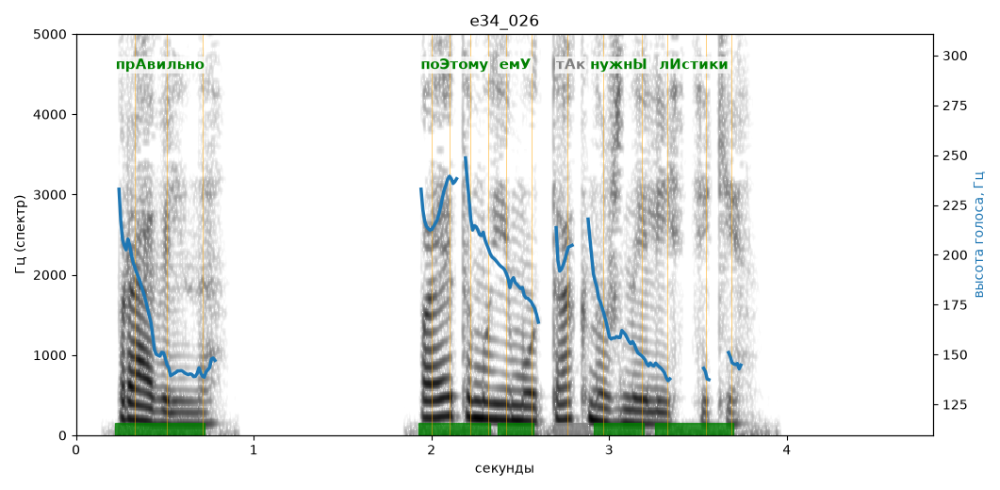

# e34_026

Голос: **edge:ru-RU-SvetlanaNeural** · длительность 4.8 с
Естественность (UTMOS): **3.98 из 5** (живой диктор ≈ 4–4.5)
Эталон: Правильно. Поэтому ему так нужны листики.
Распознано: Правильно. Поэтому ему так нужны листики.
Слова: все совпали

## Ударения
(где нужно: ruaccent)

| слово | нужно | у голоса | |
|---|---|---|---|
| правильно | прАвильно | прАвильно | ✓ |
| поэтому | поЭтому | поЭтому | ✓ |
| ему | емУ | емУ | ✓ |
| нужны | нужнЫ | нужнЫ | ✓ |
| листики | лИстики | лИстики | ✓ |

## Интонация
- ✗ «правильно.» — конец фразы не понижается — звучит незаконченно / как перечисление
- ✓ «поэтому ему так нужны листики.» — конец фразы понижается — звучит законченно
- Диапазон голоса 8.9 полутонов (живо), средняя высота 175 Гц

## Паузы и темп
- паузы на своих местах
- Темп 6.6 слога/с (быстро)

_Синяя линия — высота голоса. Над словами заглавная буква — где ударение должно быть; красным — голос поставил не туда (уверенно), оранжевым — возможно._
