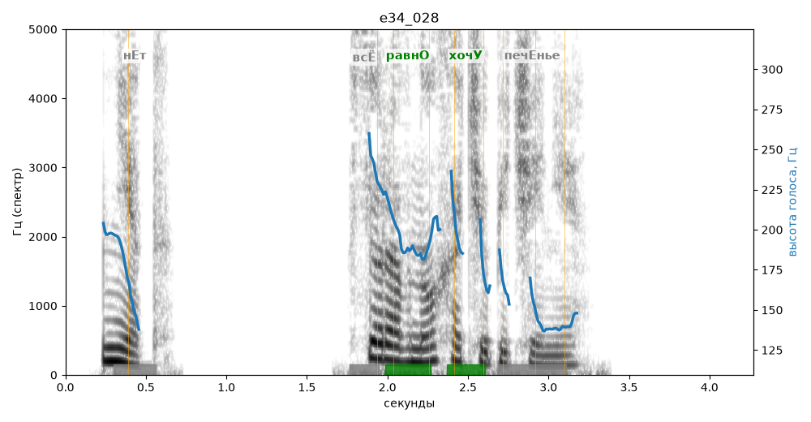

# e34_028

Голос: **edge:ru-RU-SvetlanaNeural** · длительность 4.3 с
Естественность (UTMOS): **4.04 из 5** (живой диктор ≈ 4–4.5)
Эталон: Нет. Всё равно хочу печенье.
Распознано: Нет. Всё равно хочу печенье.
Слова: все совпали

## Ударения
(где нужно: ruaccent)

| слово | нужно | у голоса | |
|---|---|---|---|
| равно | равнО | равнО | ✓ |
| хочу | хочУ | хочУ | ✓ |
| печенье | печЕнье | печеньЕ | ? не разобрать |

## Интонация
- ✓ «всё равно хочу печенье.» — конец фразы понижается — звучит законченно
- Диапазон голоса 8.9 полутонов (живо), средняя высота 185 Гц

## Паузы и темп
- паузы на своих местах
- Темп 5.6 слога/с (нормально)

_Синяя линия — высота голоса. Над словами заглавная буква — где ударение должно быть; красным — голос поставил не туда (уверенно), оранжевым — возможно._
