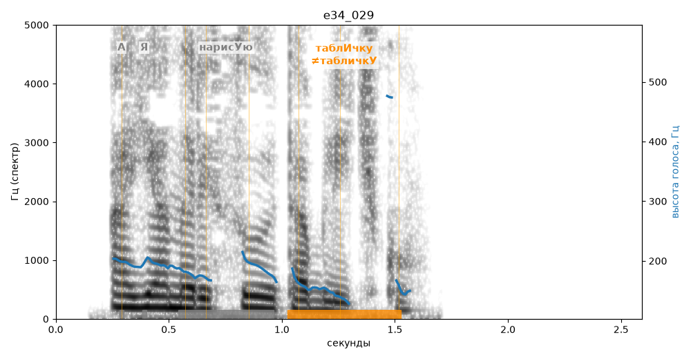

# e34_029

Голос: **edge:ru-RU-SvetlanaNeural** · длительность 2.6 с
Естественность (UTMOS): **3.86 из 5** (живой диктор ≈ 4–4.5)
Эталон: А я нарисую табличку!
Распознано: А я нарисую табличку.
Слова: все совпали

## Ударения
(где нужно: ruaccent)

| слово | нужно | у голоса | |
|---|---|---|---|
| нарисую | нарисУю | — | ? |
| табличку | таблИчку | табличкУ | ✗? возможно — послушать |

## Интонация
- ✓ «а я нарисую табличку!» — выделено слово «а» (+2.2 пт)
- Диапазон голоса 6.5 полутонов (нормально), средняя высота 181 Гц

## Паузы и темп
- паузы на своих местах
- Темп 5.6 слога/с (нормально)

_Синяя линия — высота голоса. Над словами заглавная буква — где ударение должно быть; красным — голос поставил не туда (уверенно), оранжевым — возможно._
