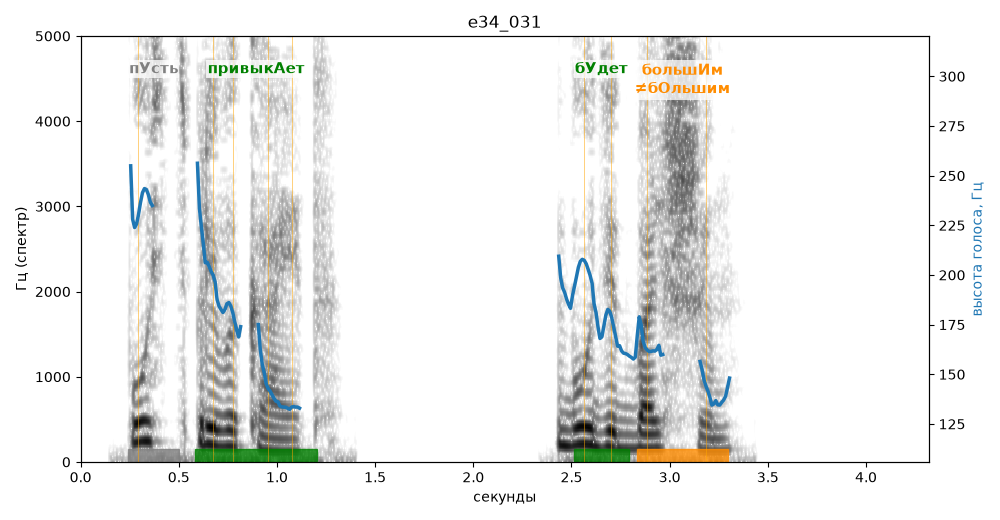

# e34_031

Голос: **edge:ru-RU-SvetlanaNeural** · длительность 4.3 с
Естественность (UTMOS): **3.91 из 5** (живой диктор ≈ 4–4.5)
Эталон: Пусть привыкает. Будет большим.
Распознано: Пусть привыкает. Будет большим.
Слова: все совпали

## Ударения
(где нужно: ruaccent)

| слово | нужно | у голоса | |
|---|---|---|---|
| привыкает | привыкАет | привыкАет | ✓ |
| будет | бУдет | бУдет | ✓ |
| большим | большИм | бОльшим | ✗? возможно — послушать |

## Интонация
- ✓ «пусть привыкает.» — конец фразы понижается — звучит законченно
- ✓ «будет большим.» — конец фразы понижается — звучит законченно
- Диапазон голоса 9.9 полутонов (живо), средняя высота 172 Гц

## Паузы и темп
- паузы на своих местах
- Темп 5.1 слога/с (нормально)

_Синяя линия — высота голоса. Над словами заглавная буква — где ударение должно быть; красным — голос поставил не туда (уверенно), оранжевым — возможно._
